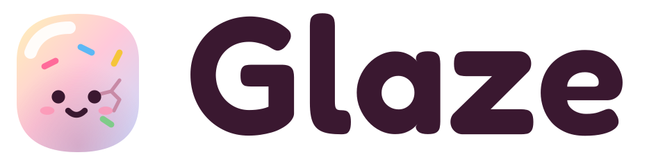

# Glaze



**Crack the glaze. Squish the frame.**

[Live demo](https://glazevideo.com)

See it live on a real site: [milenawebb.com/#glaze](https://milenawebb.com/#glaze). The demo video is streamed from [Mux](https://mux.com).

## What it is

Glaze is an ASMR squishy skin for Video.js v10. The frame around the video is a glossy candy shell you can crack, chip and peel, with a soft squishy underneath that dents under your finger, plus optional ASMR sounds.

## Features

- Four flavors: Rainbow candy, Strawberry candy, Lilac mono and Matcha mono
- Crack, chip, strip and squish the frame with your finger or mouse; use Enter to crack and R to reset with frame focus
- Optional squish and crackle sounds (off by default, the demo turns them on)
- Custom captions with a CC toggle
- Playback speed control
- Loading and replay states
- Keyboard shortcuts
- Reduced motion support
- A phone layout with finger-sized controls

## Getting started

```bash
npm install
npm run dev
```

Use the player in your own app:

```tsx
import { GlazePlayer } from "./src/glaze";

export function App() {
  return (
    <GlazePlayer
      playbackId="IL8LEwPXBY4C2HldJqjKKjtO6y5aGkQXqVPWx5cuo01g"
      title="My video"
      sounds
    />
  );
}
```

### Props

| Name | Type | Default | Description |
| --- | --- | --- | --- |
| `playbackId` | `string` | required | Mux playback ID for the video |
| `title` | `string` | `"Video"` | Accessible label for the player |
| `sounds` | `boolean` | `false` | Start with squish sounds on; a remembered viewer choice takes priority |
| `resetKey` | `number` | `0` | Changing this number puffs the frame back to smooth and re-bakes the crust |

## Keyboard shortcuts

| Key | Action |
| --- | --- |
| `Space` or `K` | Play or pause (replay when the video has ended) |
| `Left` / `Right` | Seek back/forward 5 seconds |
| `Up` / `Down` | Volume up/down 10 percentage points |
| `M` | Mute or unmute |
| `C` | Captions on or off |
| `F` | Enter/exit fullscreen |
| `Enter` (on the frame) | Crack the glaze |
| `R` (on the frame) | Reset the frame |

Use playback keys without Shift, Alt, Ctrl or Command. Space activates a focused button instead of playback and does nothing on the frame; K still controls playback there. On Seek, arrows seek 1 second, Shift+arrows and Page Up/Down seek 10 seconds, and Home/End go to the start/end. On Volume, arrows adjust by 1 percentage point and Home/End set minimum/maximum. In Speed, Up/Down move between choices and Home/End focus the first/last. Enter or Space activates buttons and sound cards. Escape closes Speed, Volume and the phone flavor picker; the browser handles leaving fullscreen. Tab/Shift+Tab move focus.

## Accessibility

- Keyboard playback, seeking, volume, captions and fullscreen, plus frame cracking and Reset, with the focus-specific rules above
- Visible focus rings for keyboard users
- Measured contrast in the tested bright/dark video and four-flavor glazed/stripped states: lowest text contrast 5.00:1; lowest essential icon contrast 4.81:1 (the stripped Rainbow face). Two-tone keyboard focus rings remain visible on light and dark surfaces. Flavor names are announced by buttons; decorative sprinkles and cheeks are not contrast indicators.
- Reduced motion: cracking, chipping, stripping and denting remain available. Chips fade in place instead of flying; frame dents still deepen and rise back. Controls do not squash, the press-me hint shows only its label, loading uses an opacity pulse, replay fades in, and sound cards use a brief highlight without movement. Sound is unchanged.
- Forced colors: controls and cards use system surfaces, text, borders and Highlight focus rings, without glass, blur or shadows.
- Reduced transparency: control bars, popups and pills use solid pink surfaces instead of glass when your browser supports the preference.
- Custom captions overlay, off by default, with a CC toggle (C key)

## Built with

- [Video.js v10](https://videojs.com) (`@videojs/react`)
- React
- TypeScript
- TanStack Start
- Tailwind CSS
- WebGL

## Credits

Designed and built by [Milena Webb](https://milenawebb.com). The demo video, ASMR whispers and all sounds were all custom made for Glaze.

## License

Apache 2.0, the same license as Video.js. See [LICENSE](LICENSE).
